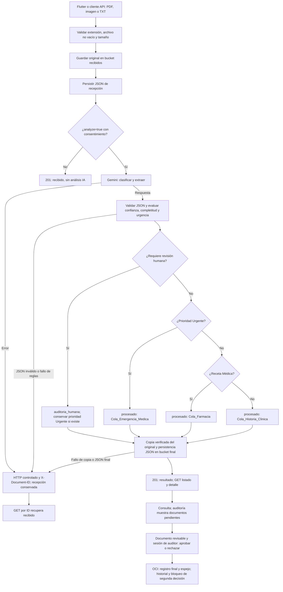

# MediFlow

MVP de clasificación, extracción estructurada y enrutamiento de documentos clínicos para Oracle ONE / NoCountry. Recibe PDF, JPG/JPEG, PNG y TXT; utiliza Google Gemini, valida el JSON con Pydantic y conserva originales, resultados y decisiones en OCI Object Storage.

<!-- Agregado por Edil, 24/10/2026: base publicada 1754017; ampliación documental autorizada e implementada localmente, todavía sin commit ni push. -->

## Alcance y estado

| Capacidad | Implementación actual |
| --- | --- |
| Entrada | Flutter con selección de archivos y cámara en Android; API multipart con límite de 10 MiB |
| IA | SDK oficial `google-genai`, modelo configurable, texto o media nativa para imágenes/PDF sin texto |
| Decisión | Pipeline condicional Python: confianza/completitud, urgencia y revisión humana |
| Persistencia | Tres buckets independientes: `recibidos`, `procesados`, `auditoria_humana`; copia verificada que conserva el original |
| Consulta | API de listado/detalle, historial web y recuperación por ID en Flutter |
| Auditoría | Panel HTML/CSS/JavaScript con aprobar/rechazar, confirmación e historial persistido |
| Usuarios | Usuario y contraseña propios de MediFlow, sesiones y permiso de auditor |
| Presentación | Web y API en el mismo origen; Tailscale aporta acceso privado y HTTPS |

Los destinos Emergencia, Farmacia, Historia Clínica y Revisión Humana son decisiones lógicas del MVP. No representan una entrega comprobada a sistemas hospitalarios externos.

El perfil `general` incorpora mínimos documentales verificables para los seis tipos. Un documento completo puede continuar automáticamente si también satisface confianza y protecciones; las ausencias esenciales, ilegibilidad y revisión previa siguen bloqueando. La [implementación de campos mínimos](docs/sprint-4/minimos-documentales-implementados.md) detalla los campos aditivos y decisiones autorizadas. La [propuesta inicial](docs/sprint-4/propuesta-campos-minimos.md) se conserva como registro.

## Arquitectura y flujo de decisión

`Flutter / web → FastAPI → OCI recibido → Gemini → validación y reglas Python → OCI resultado → consulta / revisión`.



El registro de revisión es independiente del análisis: aprobar no cambia automáticamente su prioridad ni mueve su bucket. La urgencia y la revisión humana pueden coexistir. Un fallo de Gemini conserva `recibido`; no se transforma por sí solo en una revisión humana.

El score operativo usa `min(confianza_clasificación, completitud)`, o cero ante la alerta crítica existente; el umbral es **0.70** y se aplican bloqueos documentales adicionales. Este score permanece interno. El campo público `score_confianza_clasificacion` corresponde a clasificación y no mide exactitud clínica.

## Estructura del repositorio

```text
README.md
iniciar_presentacion_local.bat
docs/
  sprint-3/                         # Entregas e informes históricos
  sprint-4/                         # Integración, usuarios, despliegue y propuestas
mediflow/
  .env.example
  requirements.txt
  backend/
    app/
      main.py                      # FastAPI
      api/routes.py                # Triaje, documentos y revisión
      auth/                        # Usuarios, sesiones y administración local
      core/                        # OCI, contrato, errores y orquestación
      models/schemas.py            # Modelos Pydantic
      services/                    # Gemini, extracción y pipeline
    tests/
  data_ai/
    dataset/                       # Normal, urgente y ambiguo
    prompts/
    rules/                         # Catálogos y perfiles vigentes
    docs/
  frontend_web/
    src/                           # HTML, CSS y JavaScript
      login/
      historial/
      auditoria/
      ingesta/                     # Maqueta conservada
      resultado/                   # Maqueta conservada
      colas/                       # Maqueta conservada
    tool/presentation_server.py
    tests/
  frontend_mobile/mediflow_app/
    lib/
    test/
    android/
    windows/
    tool/build_edil_apk.ps1
```

## Preparación del entorno

Comandos PowerShell desde la raíz de la copia del repositorio. Se necesitan Python y pip; Flutter para la aplicación, Android SDK para Android y Node.js para las pruebas web. Comprobar `flutter doctor` para los requisitos de la plataforma elegida. La verificación Python disponible se hizo con 3.14.7; Flutter declara Dart `^3.11.0` en su `pubspec.yaml`.

```powershell
if (-not (Test-Path -LiteralPath mediflow/backend/.venv/Scripts/python.exe)) {
    python -m venv mediflow/backend/.venv
}
./mediflow/backend/.venv/Scripts/python.exe -m pip install -r mediflow/requirements.txt
if (-not (Test-Path -LiteralPath mediflow/.env)) {
    Copy-Item -LiteralPath mediflow/.env.example -Destination mediflow/.env
}
```

El backend carga **`mediflow/.env`**, independientemente de dónde se ejecute. Las variables ya exportadas tienen prioridad. Completar los valores solo en el equipo servidor:

```dotenv
OCI_CONFIG_FILE=~/.oci/config
OCI_CONFIG_PROFILE=DEFAULT
OCI_BUCKET_RECIBIDOS=recibidos
OCI_BUCKET_PROCESADOS=procesados
OCI_BUCKET_AUDITORIA=auditoria_humana
GEMINI_API_KEY=
GEMINI_MODEL=
TRIAGE_RULES_PROFILE=general
MEDIFLOW_PUBLIC_ORIGIN=
```

Configurar el perfil OCI fuera del repositorio. Los tres buckets deben existir y los permisos deben permitir las operaciones del flujo. Mantener recursos OCI Always Free, como exige la consigna; su utilización se confirma en la infraestructura.

Seleccionar un modelo Gemini disponible para la cuenta y revisar su cuota/coste; no hay un modelo predeterminado. Las variables antiguas de OCI Generative AI del ejemplo no seleccionan el proveedor activo, que es Gemini.

Para HTTP local, dejar `MEDIFLOW_PUBLIC_ORIGIN` vacío. Para acceso HTTPS, establecer exactamente el origen del **equipo servidor actual**, sin ruta ni barra final. Un origen HTTPS antiguo hace que el login por localhost sea rechazado.

## Iniciar web, API y usuarios

Crear la primera cuenta en el equipo del despliegue:

```powershell
Push-Location mediflow/backend
./.venv/Scripts/python.exe -m app.auth.manage add-auditor edil
Pop-Location
./iniciar_presentacion_local.bat
```

La contraseña se introduce y confirma de forma oculta; no existe una predeterminada. El BAT escucha en `127.0.0.1:8787`, sirve únicamente el directorio web público y no inicia Tailscale ni envía documentos.

| Acceso local | Dirección |
| --- | --- |
| Salud | http://127.0.0.1:8787/ |
| Documentación API | http://127.0.0.1:8787/docs |
| Login | http://127.0.0.1:8787/web/login/index.html |
| Auditoría | http://127.0.0.1:8787/web/auditoria/index.html |
| Historial | http://127.0.0.1:8787/web/historial/index.html |

Abrir historial o auditoría puede consultar OCI. Enviar con `analyze=false` también escribe en OCI; `analyze=true` añade Gemini. El consentimiento se solicita en Flutter antes del análisis.

La sesión protege la identidad y las decisiones del auditor. La carga y los GET existentes conservan su acceso anterior. Las cuentas y sesiones se guardan en `mediflow/.local/auth.sqlite3`, excluido de Git; `cargado_por` es el usuario MediFlow autenticado o null para cargas anónimas e históricas.

Guías: [usuarios y administración](docs/sprint-4/usuarios-mediflow.md) · [presentación privada con Tailscale](docs/sprint-4/presentacion-local-tailscale.md). Tailscale aporta transporte/HTTPS; no autentica usuarios de la aplicación.

## Ejecutar Flutter

Con el servidor anterior activo, desde la raíz:

```powershell
Push-Location mediflow/frontend_mobile/mediflow_app
flutter pub get
flutter run -d windows --dart-define=API_BASE_URL=http://127.0.0.1:8787
Pop-Location
```

En un emulador Android iniciado, consultar `flutter devices` y ejecutar desde la carpeta de la aplicación:

```powershell
flutter run -d ID_REAL_DEL_DISPOSITIVO --dart-define=API_BASE_URL=http://10.0.2.2:8787
```

Sustituir el ID por el que devuelve Flutter; no es el nombre del AVD. En Windows se conserva el selector de archivos; la cámara está implementada para Android. Para teléfonos mediante Tailscale, compilar con el origen HTTPS del servidor nuevo. Los APK debug y las variantes USB están descritos en la [guía de presentación](docs/sprint-4/presentacion-local-tailscale.md).

## API vigente

| Método | Ruta | Función |
| --- | --- | --- |
| POST | `/api/triage` | Multipart `file` y `analyze` (false por defecto); genera el ID |
| GET | `/api/documents` | Documentos; filtros `status`, `prioridad` y `limit` |
| GET | `/api/documents/{document_id}` | Resultado persistido por ID |
| GET | `/api/reviews/pending` | Documentos sin decisión final |
| POST | `/api/documents/{document_id}/review` | Decisión con sesión y permiso de auditor |
| GET | `/api/documents/{document_id}/review-history` | Historial de revisión |
| POST | `/api/auth/login` | Iniciar sesión propia |
| GET | `/api/auth/session` | Consultar usuario y permiso |
| POST | `/api/auth/logout` | Revocar sesión |

La revisión recibe `decision` (`aprobado`/`rechazado`), `reviewer_id` coincidente con la sesión, `observacion` y `expected_review_status="pendiente"`. Rechazar exige observación. El backend genera el ID y la fecha UTC; una segunda decisión final devuelve 409. No existe `PUT /approve`.

Contrato: [Pydantic](mediflow/backend/app/models/schemas.py) · [ejemplo original](mediflow/backend/app/core/contrato.json) · [ejemplos de los seis tipos ampliados](mediflow/backend/app/core/contrato.campos-minimos-v1.example.json) · [detalle y compatibilidad](mediflow/backend/app/core/detalleContrato.md).

## Verificación y demostración

La ampliación local de mínimos documentales pasó **711 pruebas Python y 29 subcasos**, **195 pruebas web** y **187 Flutter**; Flutter analyze sin problemas. Se excluyeron seis pruebas Python externas y se omitieron dos Flutter opt-in. Las pruebas externas omitidas no cuentan como aceptación de OCI/Gemini; esta verificación no usó servicios reales. Resultados: [evidencia de mínimos](docs/sprint-4/evidencias/minimos-documentales-24-octubre.json).

Para ejecutar únicamente las pruebas locales Python:

```powershell
Push-Location mediflow/backend
$env:RUN_OCI_INTEGRATION="0"
$env:RUN_S4_REVIEW_INTEGRATION="0"
./.venv/Scripts/python.exe -m pytest tests ../data_ai ../frontend_web/tests/test_presentation_server.py -m "not integration"
Pop-Location
```

Pruebas web, después de preparar el entorno Python del backend:

```powershell
Push-Location mediflow/frontend_web
node --test tests/*.test.js
Pop-Location
Push-Location mediflow/frontend_mobile/mediflow_app
flutter analyze
flutter test
Pop-Location
```

Preparar la demostración final con **Rutina, Urgencia y Ambigüedad**. Hay [evidencia histórica de los tres escenarios](docs/sprint-3/cierre-integracion-eliana.md); la aceptación del despliegue actual se hará en el otro equipo. El perfil opt-in `synthetic_demo_v1` conserva reglas experimentales del dataset confirmado sintético; no sustituye la política general ni valida contenido ausente del contrato.

Documentación: [aceptación del panel con OCI](docs/sprint-4/aceptacion-revision-real.md) · [mínimos documentales implementados](docs/sprint-4/minimos-documentales-implementados.md) · [paquete base publicado](docs/sprint-4/entrega-main-24-octubre.md).

Se conservan maquetas y entregas históricas, identificadas como tales. Las alertas visuales están implementadas; `notificacion_generada` es null y no acredita envío de correo/Slack. OCI Compute, notificaciones externas y LangGraph/n8n no son requisitos obligatorios del MVP.

## Equipo y organización histórica

| Área | Aportes |
| --- | --- |
| Nicolás | Dataset, prompt y detección de urgencias |
| Laura | Estados, confianza, completitud y perfiles documentales |
| Drazen | API de documentos y revisión |
| Eliana | Contratos, orquestación e integración |
| Brando | Persistencia OCI, errores y copia verificada |
| Flor | Wireframes y maquetas web originales |
| Edil | Flutter, integración y cierre del panel web, usuarios y presentación |

### Organización Sprint 1

En Sprint 1 cada integrante trabajó en su carpeta asignada, sobre main y sin integración entre módulos. Desde Sprint 2 se introdujo la integración mediante ramas y Pull Requests. Los informes originales conservan la atribución de entregas iniciales, incluida la participación histórica de José, quien ya no forma parte del equipo activo.

## Secretos y límites de entrega

`.env`, archivos PEM/KEY, credenciales OCI, base de usuarios, sesiones, APK y cachés están excluidos de Git. Se publica únicamente `.env.example` con secretos vacíos. Los informes de sprints son registros fechados; el código y las guías vigentes prevalecen sobre instrucciones históricas.
