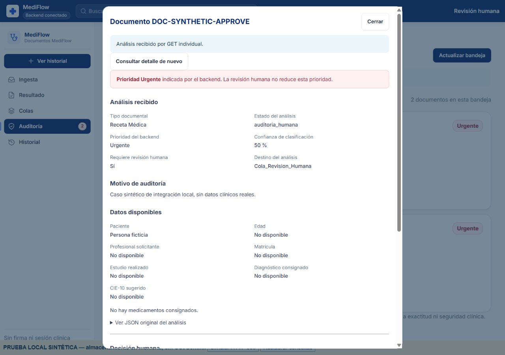
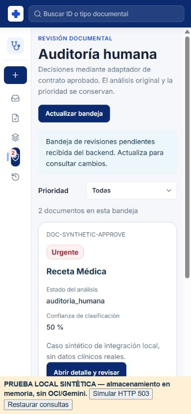
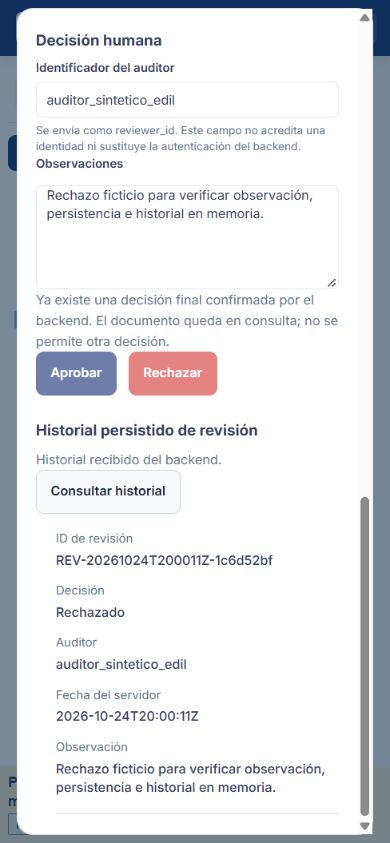

# S4-07 — Edil: cierre técnico local y presentación

Agregado por Edil — 24 de octubre de 2026, America/La_Paz.

**Decisión vigente:** Tailscale solo proporciona acceso de red. Los usuarios y
contraseñas de auditoría pertenecen a MediFlow; implementación y administración
en [usuarios-mediflow.md](usuarios-mediflow.md). La primera cuenta se creará en
el equipo del despliegue; no se solicita una cuenta Tailscale como auditor.

**Actualización posterior del mismo día:** se aprobó avanzar con el contrato,
se conectó `cargado_por` y se implementaron identidad y permisos en backend/web.
La lista de auditores permanece vacía por falta de cuentas concretas; las
decisiones reales siguen bloqueadas. El cierre que sigue se conserva como
registro del estado anterior. Estado vigente, pruebas y dependencias:
[contrato-revision-identidad.md](contrato-revision-identidad.md).

**Resultado:** implementación y preparación local completadas en el alcance
ejecutable desde esta PC. No se declara aceptación integral del Sprint 4:
quedan pruebas físicas posteriores indicadas por el usuario y dependencias del
equipo. No se hicieron commits ni push.

## Base y preservación

Rama: `integration/sprint-4-2026-10-23`. HEAD y main conservan
`b2777d30dd3c7315675b8d449f13a3f2ac2c9f4e`.
Se respaldaron los 36 archivos pendientes y el índice antes de trabajar en
`C:\Users\leno\AppData\Local\Temp\MediFlow-S4-Edil-cierre-24oct-pz3yw69r`.
Los cambios de Brando, Drazen, Eliana y Laura no se reescribieron.
Tampoco se modificaron backend, data_ai ni la lógica Dart de Flutter en este cierre.

El índice de 36 archivos de la integración anterior se conserva. Hay cambios
nuevos de Edil en la carpeta de trabajo y archivos nuevos: antes de un futuro
commit hay que revisar su inventario actualizado; no usar sin revisión el
manifiesto del 23/10 como si incluyera este cierre.

## Checklist de Edil

| Trabajo | Estado y evidencia |
| --- | --- |
| Base Sprint 3 consolidada | Hecho; base `b2777d3` y nueva integración S4 conservada sin commit |
| Bandeja y detalle web | Implementados; lecturas mediante endpoints existentes, filtros y validación |
| Observaciones, confirmar/cancelar, aprobar/rechazar, historial | Implementados; comprobados en navegador con FastAPI y SDK sustituido en memoria, con autorización del usuario para ambas decisiones ficticias |
| Prioridad y análisis originales | Urgente permanece independiente de auditoría; el JSON original no se sobrescribe |
| Estados vacío/error/red | Verificados visualmente; ante HTTP 503 se mantiene la bandeja previa y se permite recuperar |
| Prevención de otra decisión final | Corregida y probada al actualizar detalle y al encontrar un registro final en historial |
| Escritorio/móvil web | Verificado en navegador a 1280, 390 y 360 px, sin desbordamiento horizontal de página; capturas sintéticas adjuntas |
| Flutter analyze/test | Sin problemas; 178 pruebas aprobadas y dos reales omitidas |
| APK | Tres APK debug nuevos, firmas v2 verificadas, hashes y ausencia de assets .env/.pem/.key comprobados |
| Presentación local y HTTPS | Web/API en un origen, servidor loopback y Tailscale Serve privado activado por autorización del usuario; salud, HTML y OpenAPI verificados por HTTPS |
| Guion/README/documentación | Guía de arranque, comandos, guion y evidencia disponibles |
| Teléfono físico, cámara, red y APK instalado | Pendiente del usuario, que indicó que hará las pruebas después; no se marcaron como realizadas |
| Aceptación web–OCI–Gemini real de esta integración | Pendiente de ejecución coordinada; no se confundió la prueba en memoria con OCI real |

## Correcciones realizadas

1. **Ocultado visual:** los estilos compartidos `.empty` y `.btn` podían anular
   `hidden`. Se veía «No hay documentos» junto a filas existentes. Se añadió
   una regla acotada al panel y se verificó `display: none` en navegador.
2. **Decisión final:** actualizar un detalle después del éxito podía volver a
   habilitar los botones. Ahora se bloquean documentos confirmados en la sesión
   y decisiones finales obtenidas de un historial válido. No se atribuye una
   revisión de otra persona al envío incierto ni se fabrica recibo de éxito.
3. **Caché:** se versionaron los assets modificados para que la presentación
   no use el CSS/controlador anterior del navegador.
4. **Origen remoto:** el servidor de presentación sirve únicamente el directorio
   público y configura la API con `window.location.origin`; el teléfono no
   intenta consultar su propio localhost.
5. **Contrato pendiente:** el servidor de presentación bloquea también el POST
   de revisión con HTTP 403 mientras no se habilite explícitamente el contrato;
   el bloqueo no depende solo de botones. La API original no se reescribió.

El prototipo original se mantiene inerte. No se alteraron contratos, umbrales,
reglas de urgencia ni fuentes de los demás integrantes.

## Pruebas del 24/10

| Verificación | Resultado |
| --- | --- |
| JavaScript | **144 pruebas aprobadas**, sin fallos ni omitidas |
| Backend/data_ai y presentación | **478 pruebas y 29 subcasos aprobados**: 473 de la base integrada y cinco del servidor de presentación; seis externas excluidas |
| Flutter test | **178 aprobadas**, dos opt-in externas omitidas |
| Flutter analyze | **Sin problemas** |
| APK | Compilación debug emulador, USB y Tailnet correcta; tres firmas verificadas con apksigner |
| HTTPS privado | HTTP 200 en salud, HTML del panel y OpenAPI; validación TLS normal, sin desactivarla |

Dos avisos de dependencias Python no causaron fallos. No se ejecutaron pruebas
reales de OCI/Gemini. La prueba visual usa documentos ficticios autorizados y
almacenamiento en memoria; no acredita persistencia cloud ni validación clínica.

Registros completos, fuera de Git:

- Web: `C:\Users\leno\AppData\Local\Temp\MediFlow-S4-Edil-web-24oct-egt0jut0\tests.log`.
- Python final: `C:\Users\leno\AppData\Local\Temp\MediFlow-S4-Edil-final-python-24oct-5v26k_x_\tests.log`.
- Flutter: `C:\Users\leno\AppData\Local\Temp\MediFlow-S4-Edil-flutter-24oct-f2d7412506804d07a301f46658376ce5\analyze.log` y `tests.log`.

## Artefactos y capturas

Los APK se encuentran en `mediflow/frontend_mobile/mediflow_app/build/edil-s4/`
y permanecen ignorados por Git:

| APK debug | API configurada | Uso |
| --- | --- | --- |
| `mediflow-s4-emulator.apk` | `http://10.0.2.2:8000` | Emulador Android, backend habitual en PC |
| `mediflow-s4-usb.apk` | `http://127.0.0.1:8000` | Teléfono con `adb reverse`; prueba física posterior |
| `mediflow-s4-tailnet.apk` | `https://desktop-2amsjb6.tailf48a22.ts.net` | Presentación privada con teléfono conectado a la tailnet |

Son builds debug universales, no binarios de tienda; la firma release del
proyecto todavía es debug. El helper `tool/build_edil_apk.ps1` impide llamarlo
distribución final. No se crearon claves de firma ni se añadieron secretos.

Evidencia: `evidencias/edil-s4-browser-24-octubre.json`,
`evidencias/edil-s4-tailscale-24-octubre.json` y
`evidencias/edil-s4-cierre-24-octubre.json`.

### Escritorio — datos sintéticos

### Móvil — datos sintéticos

## Presentación disponible

- Panel privado: `https://desktop-2amsjb6.tailf48a22.ts.net/web/auditoria/index.html`.
- Swagger: `https://desktop-2amsjb6.tailf48a22.ts.net/docs`.
- Arranque posterior: `iniciar_presentacion_local.bat`, mantener la PC conectada.
- Guion, instalación posterior, apagado y alternativas USB: [guía de Tailscale](presentacion-local-tailscale.md).

El servidor de presentación local y Serve quedan activos para la presentación.
Las lecturas del panel real pueden consultar OCI cuando el usuario lo abra;
esta revisión solo verificó por HTTPS salud/HTML/OpenAPI, sin documentos.
No se activó Funnel ni se hicieron cambios en router, ACL o credenciales.
Las decisiones reales permanecen deshabilitadas en la interfaz y en el servidor
de presentación hasta aprobar y habilitar el contrato.

## Qué depende de los demás

| Dependencia | Responsable | Qué desbloquea |
| --- | --- | --- |
| Aprobar el contrato de decisiones y su habilitación | Equipo, con Drazen/Eliana | Uso real de Aprobar/Rechazar; el frontend y adaptador ya están preparados |
| Definir y propagar `cargado_por` | Eliana y backend, con validación del equipo | Coherencia entre ejemplo/documentación, modelo, carga y persistencia; no inventar un profesional desde Flutter |
| Identidad/autorización del auditor y permisos | Drazen/backend y responsable de despliegue | Que `reviewer_id` no dependa de una identidad declarada por el cliente; Tailscale no sustituye ese control |
| Aceptación E2E con OCI y matriz final S4-03-17 | Eliana con Drazen/Brando, apoyo de Edil | Evidencia cloud del panel final, fallos parciales y consistencia del historial |
| Validación funcional de perfiles/urgencia para la demo | Laura/Nicolás y equipo | Aceptación de resultados; no requiere rehacer reglas en Flutter |

La prueba física del teléfono **no está bloqueada por los compañeros**: requiere
el dispositivo y el tiempo del usuario. El APK debug/HTTPS ya está preparado.
La autorización de commit/push/fusión tampoco es una tarea técnica faltante:
permanece detenida por instrucción del usuario.

## Aceptación posterior pendiente del usuario

Instalar el APK elegido; comprobar cámara, revisión de foto, TXT/PDF/imagen,
consentimiento, POST, resultado, GET por ID y pérdida de conectividad con datos
sintéticos. Registrar capturas y resultado real. No sustituir estas pruebas por
la compilación ni por las 178 pruebas automatizadas.

**Cierre técnico local de Edil preparado; cierre de aceptación física y E2E real
pendiente.** No se afirma que todo el Sprint 4 esté terminado.
